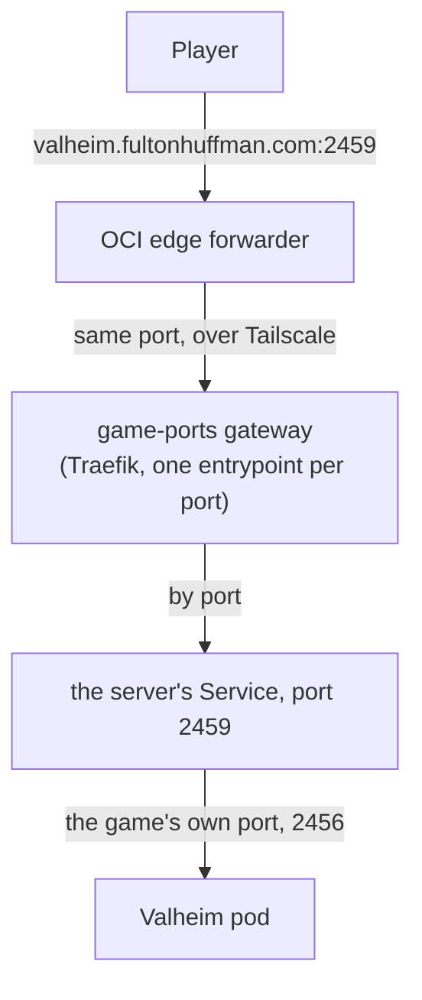

# game-ports

Public addresses for Gameplane servers of games whose clients don't send the
hostname they connect to: Valheim and Factorio. Minecraft clients do, so
every Minecraft server shares one public port
(`kubernetes/apps/minecraft-gateway`). These games can't share a port, so each
server gets public ports of its own, handed out automatically when a friend
creates it.

| Game | Address | Ports |
|------|---------|-------|
| Valheim | `valheim.fultonhuffman.com` | 2456-2467: 4 servers, 3 ports each |
| Factorio | `factorio.fultonhuffman.com` | 34197-34202: 6 servers |

A game's first server has the game's default port, so players need only the
name: `factorio.fultonhuffman.com`. Later servers add their port:
`factorio.fultonhuffman.com:34198`. The dashboard shows each server's address.



## How a server gets its address

1. **The gameplane app's policies** (`kubernetes/apps/gameplane`,
   `templates/game-ports.yaml`) make each new Valheim or Factorio server a
   LoadBalancer, and give its Service this app's load-balancer class,
   `homelab.io/game-ports`. MetalLB leaves Services of another class alone,
   so this app is their load balancer.
2. **The controller** (`images/game-ports`) gives each server a slot, the
   lowest free one for its game, and sets the server's `portOverrides` to the
   slot's public ports. Gameplane then publishes the Service on those ports
   and still forwards them to the game's own. The overrides are the record of
   the slot, so the controller keeps nothing else: after a restart it reads
   each server's slot back from its ports.
3. The controller writes the game's hostname into the Service's
   load-balancer status. Gameplane shows that hostname and the Service's port
   as the server's address.
4. The controller writes the gateway's routes, one per port, to the
   `game-ports-routes` ConfigMap. The gateway's Traefik watches it, so it
   needs no Kubernetes access of its own. Routes go to the Service's cluster
   name, so they follow Gameplane's wake sentinel while a server sleeps. A
   new route reaches the gateway within a minute or two, as the kubelet
   refreshes the ConfigMap.

Deleting a server frees its slot and removes its routes.

Every player reaches the game from the gateway's address, so use each game's
own access control: a server password.

## Checks and the canary

This app depends on how Gameplane behaves today, which nothing guarantees
across upgrades:

- it keeps the Service's load-balancer class and the status the controller
  writes;
- it shows the status hostname and the Service's port as a server's address;
- a port override still forwards to the game's own port.

So on every pass (every 10 seconds), the controller checks each server that
has settled: its Service's class and ports, and the address Gameplane shows.
It also runs a **canary**, `game-ports-canary`: a tiny UDP echo server of its
own game (`templates/canary.yaml`) on port 39999. The controller sends it a
packet at `game-ports-canary.fultonhuffman.com:39999`, out to the internet
and back in through the edge, the tailnet and the gateway, so the check
covers DNS, the edge, the tailnet grant and the gateway too. It recreates the
canary daily, so Gameplane's create path, where the policies set the Service's
class, is checked again after every upgrade.

When every check passes, the controller sets
`game_ports_checks_last_success_timestamp_seconds`. The **Game Ports Checks
Failing** alert fires when that is more than 15 minutes old, for 10 minutes.
The controller's log names each failing check:

```sh
kubectl -n game-ports logs deploy/game-ports-controller
```

The canary's template shows in the dashboard's New Server wizard as "Health
check (don't use)", since Gameplane can't hide a template. A server made
from it just echoes, with no public ports.

## Adding ports or a game

The ranges are set in three places, which must match; CI checks that they
do (`.github/scripts/check_game_ports.py`):

1. `games` in `values.yaml`, for the gateway and the controller.
2. `var.games` in `opentofu/oci-forwarder/variables.tf`, for the edge, as
   port ranges.
3. The `tag:edge` → `tag:k8s-games` grant in `tailscale/policy.hujson`.

A new game also goes in `gamePorts.templates` in the gameplane app. Its
`basePort` must be the template's first advertised port, and
`portsPerServer` at least the number of ports it advertises. Only UDP ports
are routed. Then apply the edge as its README describes ("Game servers").

## Notes

- **A full game:** a server created when all its game's slots are taken gets
  no public ports, and the checks fail, so the alert fires. Raise `servers`
  (and the edge ranges) to make room.
- **Servers created before the policy** keep their MetalLB LAN address,
  because a Service's class can't be changed. Recreate them to make them
  public.
- **Players at home** go out through the edge too, since these servers have
  no LAN address.
- **Valheim's Steam server list** shows the home connection's address, not
  the edge's, so players should join with the dashboard's address.
