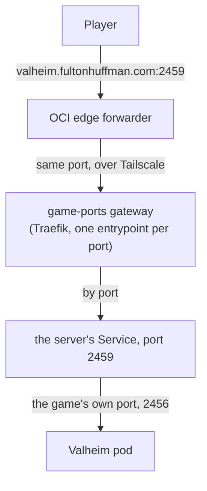

# game-ports

Public addresses for Gameplane servers of games whose clients don't send the
hostname they connect to: Valheim and Factorio. Minecraft clients do, so
every Minecraft server shares one public port
(`kubernetes/apps/minecraft-gateway`). These games can't share a port, so each
server gets public ports of its own. Gameplane's own operator hands them out
(`operator.portPools` in the gameplane app); this app routes and addresses
them.

| Game | Address | Ports |
|------|---------|-------|
| Valheim | `valheim.fultonhuffman.com` | 2456-2467: 4 servers, 3 ports each |
| Factorio | `factorio.fultonhuffman.com` | 34197-34202: 6 servers |

A game's first server gets the game's default port, so players need only the
name: `factorio.fultonhuffman.com`. Later servers add their port:
`factorio.fultonhuffman.com:34198`. The dashboard shows each server's full
address.



## How a server gets its address

1. **The gameplane app's `operator.portPools`** gives every Valheim and
   Factorio server a contiguous block of its pool, kept for the server's
   life, and publishes those ports on its Service. See
   GameplanePanel/Gameplane#1001 and the
   [Port Pools docs](https://github.com/GameplanePanel/Gameplane/blob/main/docs/networking.md#port-pools).
   The operator also labels the Service `gameplane.local/port-pool`.
2. **The gameplane app's `templates/game-ports.yaml`** makes the server's
   Service a LoadBalancer of this app's class (`gamePorts.loadBalancerClass`,
   GameplanePanel/Gameplane#1000), which keeps MetalLB off it, and gives it
   the game's public hostname (`gamePorts.hostnames`,
   `spec.networking.hostname`).
3. **The controller** (`images/game-ports`) lists Services of our class
   labeled `gameplane.local/port-pool` and writes the game's public
   hostname into each one's load-balancer status, so Gameplane shows it
   with the Service's port as the server's address
   (GameplanePanel/Gameplane#999): `valheim.fultonhuffman.com:2459`.
4. **The controller** also writes the gateway's routes, one per port, to
   the `game-ports-routes` ConfigMap. The gateway's Traefik watches it, so
   it needs no Kubernetes access of its own. Routes go to the Service's
   cluster name, so they follow Gameplane's wake sentinel while a server
   sleeps. A new route reaches the gateway within a minute or two, as the
   kubelet refreshes the ConfigMap.

Deleting a server frees its block within Gameplane and removes its routes
here.

Every player reaches the game from the gateway's address, so use each game's
own access control: a server password.

## Checks and the canary

Every pass (every 10 seconds), the controller also runs a **canary**: a
static UDP echo server of its own (`templates/canary.yaml`), on port 39999 -
not a Gameplane GameServer, so it needs no template or recreation. The
controller sends it a packet at `game-ports-canary.fultonhuffman.com:39999`,
out to the internet and back in through the edge, the tailnet and the
gateway, so the check covers DNS, the edge, the tailnet grant and the
gateway together.

When the canary echoes, the controller sets
`game_ports_checks_last_success_timestamp_seconds`. The **Game Ports Checks
Failing** alert fires when that is more than 15 minutes old, for 10 minutes.
The controller's log names each failure:

```sh
kubectl -n game-ports logs deploy/game-ports-controller
```

## Adding ports or a game

The ranges are set in three places, which must match; CI checks that they
do (`.github/scripts/check_game_ports.py`):

1. `pools` in `values.yaml`, for the gateway's entrypoints.
2. `var.games` in `opentofu/oci-forwarder/variables.tf`, for the edge, as
   port ranges.
3. The `tag:edge` → `tag:k8s-games` grant in `tailscale/policy.hujson`.

A new game also needs its own `operator.portPools` entry and
`gamePorts.hostnames` entry in the gameplane app, naming its template; the
pool's `ports` must match the range here, and the hostname must match a
`pools[].hostname` entry here too. The controller needs no other change: it
routes and addresses whichever pool-labeled Service actually holds a port.
Then apply the edge as its README describes ("Game servers").

## Notes

- **A full pool:** a server created when its pool has no free block gets no
  Service or address, and reports `PoolExhausted` (Gameplane's own
  condition, not a game-ports check). Raise the pool's range (and the edge's)
  to make room.
- **Players at home** go out through the edge too, since these servers have
  no LAN address.
- **Valheim's Steam server list** shows the home connection's address, not
  the edge's, so players should join with the dashboard's address.
