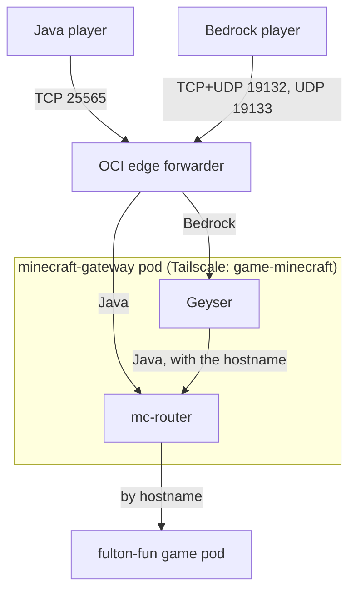

# Minecraft gateway

The front door to every Gameplane Minecraft server, for Java and Bedrock
players alike. Players join `<server>.minecraft.fultonhuffman.com`, and the
gateway sends them to that server.



One pod runs both:

- **mc-router** routes Java players by the hostname their client sends. It
  finds servers by the `mc-router.itzg.me/externalServerName` annotation on
  their Services, in any namespace. Gameplane adds it to every Minecraft
  server (`kubernetes/apps/gameplane`, `templates/minecraft-names.yaml`).
- **Geyser** (Standalone, from `images/geyser-standalone`) translates Bedrock
  to Java and connects to mc-router on `localhost`, passing on the hostname
  the Bedrock player used (`forward-hostname`). So Bedrock players reach the
  same servers by the same names.

The pod's Service is a Tailscale LoadBalancer, `game-minecraft`, tagged
`tag:k8s-games`, the target of the edge's grant in `tailscale/policy.hujson`.
The edge forwards these ports to it (`opentofu/oci-forwarder`,
`var.games`):

| Port | Players | Use |
| --- | --- | --- |
| TCP 25565 | Java | the game |
| TCP 19132 | Bedrock | signaling: how a Bedrock client finds the server |
| UDP 19132 | Bedrock | RakNet, older Bedrock clients |
| UDP 19133 | Bedrock | NetherNet (WebRTC), current Bedrock clients |

Geyser tells Bedrock clients to send their NetherNet traffic to
`geyser.publicHost`, the edge's public name. It looks that name up when it
starts, so after the DNS record first exists, restart the pod.

## Joining

- **Java:** add a server at `<server>.minecraft.fultonhuffman.com`, no port.
- **Bedrock** (iPad, phone, Windows): **Servers → Add Server**, address
  `<server>.minecraft.fultonhuffman.com`, port `19132`. Consoles can't add
  servers.

Bedrock players join without a Java account, through Floodgate: Geyser
vouches for them with a key, and each server's Floodgate plugin trusts it.
The key is `floodgate-key`, 16 random bytes kept in Bitwarden, and every
Paper server gets the same key and the plugin (`kubernetes/apps/gameplane`).
Their names in game start with a dot, eg `.Theo`.

The ports are open to the whole internet, so every server needs its
whitelist on before its name is shared. Add Bedrock players with Floodgate's
`fwhitelist add <gamertag>` in the server's console.

## Troubleshooting

```sh
kubectl -n minecraft-gateway logs deploy/minecraft-gateway -c mc-router
kubectl -n minecraft-gateway logs deploy/minecraft-gateway -c geyser
```

- **A player can't connect, and mc-router's log shows no backend for the
  hostname:** the server's Service has no annotation, or a different name.
  Check it with
  `kubectl -n gameplane-games get svc <server> -o jsonpath='{.metadata.annotations}'`.
  A server created before the naming policy gets its name when it's
  stopped and started in the dashboard. Gameplane's **restart** isn't
  enough: it restarts the game inside the same pod and doesn't update the
  server.
- **Java works but Bedrock doesn't:** check Geyser's log for signaling, and
  that `geyser.publicHost` resolves to the edge. A Bedrock player who
  connects but is refused by the server usually means the server has no
  Floodgate plugin, or a different key.
- **mc-router sends players to port 25565 of the server's Service,** the
  port every Gameplane Minecraft template uses. A server on another port
  needs its Service port named `mc-router` or `minecraft`, which mc-router
  uses first.
- **Every player appears to come from the edge,** so IP bans and per-IP limits
  in the game see one client. Use whitelists.
