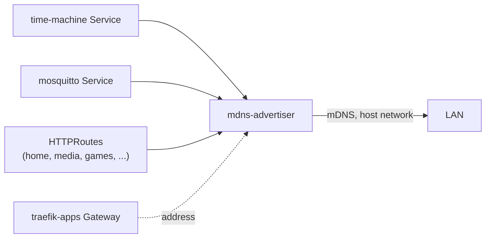

# mdns-advertiser

Central mDNS advertisement service for LAN device discovery. Advertises services
via Zeroconf/Bonjour using the prebuilt `ghcr.io/bafulton/mdns-advertiser` image
(built from [`images/mdns-advertiser/`](../../../images/mdns-advertiser/)).

## How It Works

Records come from annotations on the objects being advertised, in the style of
[external-dns](https://github.com/kubernetes-sigs/external-dns), so they
follow those objects' lifecycle and their addresses are never copied by hand:

- **Services** annotated `mdns.homelab.io/hostname` are published at their
  load balancer address. Mosquitto, Time Machine and the Gameplane Minecraft
  servers use this.
- **HTTPRoutes** annotated `mdns.homelab.io/advertise: "true"` publish each
  `.local` hostname at their Gateway's address. The `gateway-route` chart adds
  this for a route's `mdns:` block.

The advertiser lists both every 30 seconds and publishes the result over mDNS
on the host network. A record is removed when its object is, and a failed list
changes nothing.



## Annotations

| Annotation | Meaning | Default |
| --- | --- | --- |
| `mdns.homelab.io/hostname` | On a Service: publish it as `<hostname>.local` | (required) |
| `mdns.homelab.io/advertise` | On an HTTPRoute: `"true"` publishes its `.local` hostnames | (required) |
| `mdns.homelab.io/name` | Display name in Finder and network browsers | the hostname |
| `mdns.homelab.io/types` | Service types: comma-separated, or a JSON list of `{"type", "txtRecords"}` for types with TXT records | `_http._tcp` |
| `mdns.homelab.io/port` | Port | the Service's first port, or the route's Gateway listener |
| `mdns.homelab.io/ip` | Address override, eg to publish a name at another Service's address | from status |

## Adding mDNS to an App

A web app sets `mdns:` on its LAN route in `gateway-route` (see
[charts/README.md](../../../charts/README.md#mdns-advertisement)). Anything with
its own LoadBalancer annotates its Service:

```yaml
service:
  annotations:
    metallb.io/loadBalancerIPs: "192.168.1.201"
    mdns.homelab.io/hostname: timemachine
    mdns.homelab.io/name: Time Machine
    mdns.homelab.io/types: |
      [{"type": "_smb._tcp"},
       {"type": "_adisk._tcp", "txtRecords": ["sys=adVF=0x100", "dk0=adVN=Family,adVF=0x82"]}]
```

## Debugging

Check advertiser logs:
```bash
kubectl logs -n mdns-advertiser deploy/mdns-advertiser
```

List what it reads:
```bash
kubectl get svc -A -o json | jq -r '.items[] | select(.metadata.annotations["mdns.homelab.io/hostname"]) | "\(.metadata.namespace)/\(.metadata.name)"'
kubectl get httproute -A -o json | jq -r '.items[] | select(.metadata.annotations["mdns.homelab.io/advertise"] == "true") | "\(.metadata.namespace)/\(.metadata.name)"'
```

Test mDNS resolution from a Mac:
```bash
dns-sd -B _http._tcp local.
dns-sd -L "Home Assistant" _http._tcp local.
```

`dns-sd` buffers its output when stdout isn't a terminal, so it prints nothing
when piped or captured. Give it a pty to script against it:
```bash
script -q /dev/null timeout 5 dns-sd -B _adisk._tcp local
```
